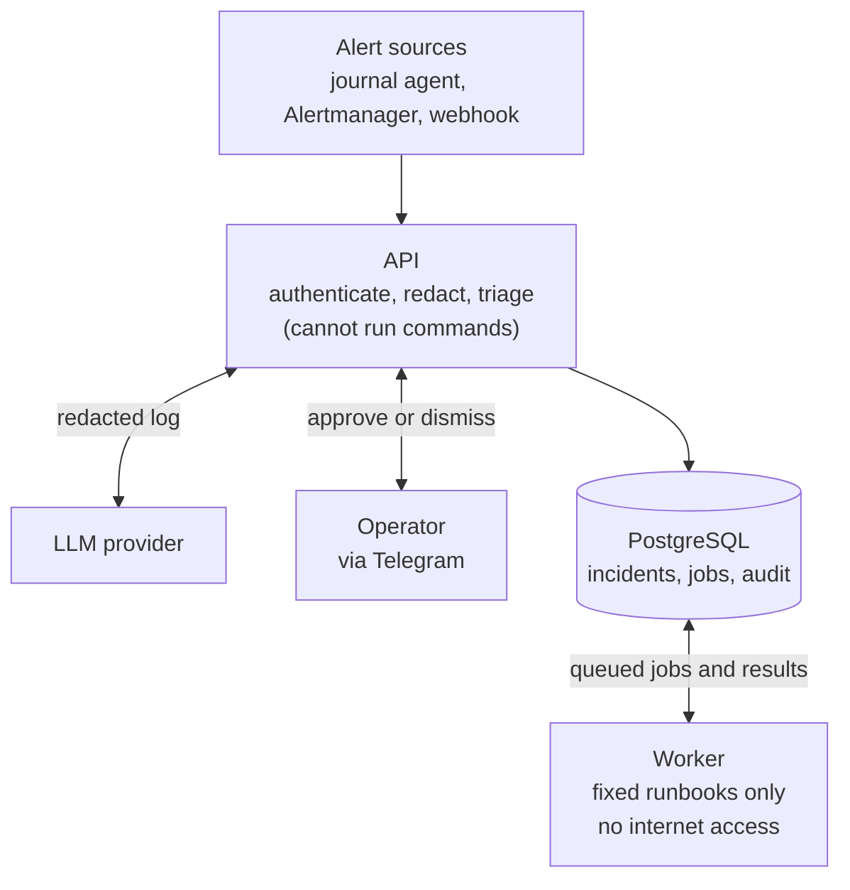
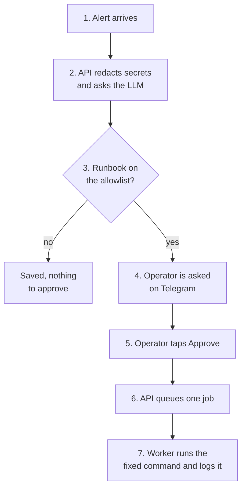

<h1 align="center">GreenLight</h1>

<p align="center">
  
  
  
  
</p>

<p align="center">
  <a href="#overview">Overview</a> ·
  <a href="#architecture">Architecture</a> ·
  <a href="#quick-start">Quick start</a> ·
  <a href="#api">API</a> ·
  <a href="#testing">Testing</a> ·
  <a href="#limitations">Limitations</a>
</p>

---

## Overview

A self-hosted incident-response service. When a server alert fires, it asks an LLM to diagnose the problem, sends the proposed fix to an engineer on Telegram, and runs the fix only after they approve it.

**The problem.** When a service breaks at 3 a.m., someone has to read the logs, work out the cause and run the right fix. An LLM can do the diagnosis, but letting it run commands on production is dangerous, because the logs it reads can be manipulated. GreenLight automates the diagnosis and keeps a person in control of every action.

> **Example:** the payment service crashes. GreenLight reads the error, proposes the `payment_gateway_restart` runbook and sends it to your phone. You tap **Approve**, a worker runs the fixed restart command, and the audit log records who approved it and what happened.

### How it stays safe

| Rule | How it is enforced |
| --- | --- |
| The LLM only picks a key | Runbook commands are fixed in code. A key that is not on the list is discarded. |
| A human approves every run | Single-use token, expires after 5 minutes, only for authorized operators. |
| Only the worker executes | A separate process with no inbound ports and no internet access. |

## Architecture

The API never executes commands. PostgreSQL is the only thing the API and the worker share.



## How an incident flows



- The approval token is single-use and expires after 5 minutes (configurable).
- **Dismiss** closes the incident without running anything.
- If the LLM is missing, fails, or proposes a key that is not on the list, the incident is still saved, with nothing to approve.

## Tech stack

| Area | Tools |
| --- | --- |
| API | Python 3.11, FastAPI, Pydantic |
| Data | PostgreSQL 16 (SQLite for local development), SQLAlchemy 2, psycopg 3 |
| AI | Any OpenAI-compatible endpoint (Groq in the example config) |
| Integrations | Telegram Bot API, Prometheus Alertmanager, systemd journal, optional n8n |
| Delivery | Docker Compose, Caddy for TLS, GitHub Actions |
| Quality | pytest, ruff, shellcheck |

## Quick start

**1. Configure and start the stack** (PostgreSQL, API on `127.0.0.1:8000`, worker):

```bash
cp .env.example .env
docker compose up --build
```

**2. Send a sample incident:**

```bash
./scripts/simulate_incident.sh
```

Without an LLM key, the incident is saved with `status: PENDING` and no `remediation_key`, which shows the "nothing to approve" path.

**3. Try the full loop.** Set `LLM_API_KEY` (any OpenAI-compatible endpoint) and the `TELEGRAM_*` variables in `.env`, then repeat step 2. Remediation stays in `dry-run` mode and the bundled runbooks only `echo`.

<details>
<summary><b>Run without Docker</b> (SQLite, no database setup)</summary>

```bash
python -m venv .venv && source .venv/bin/activate
pip install -e ".[dev]"
cp .env.example .env
uvicorn greenlight.main:app --reload     # API docs at http://127.0.0.1:8000/docs
python -m greenlight.worker              # in a second terminal
```

In development, an endpoint is open while its key is unset. With `APP_ENV=production` the API will not start until every required secret is set.

</details>

An optional n8n workflow can forward finished jobs to Slack or Discord. See [integrations](docs/integrations.md#n8n-optional).

## API

| Endpoint | Auth | Purpose |
| --- | --- | --- |
| `POST /api/v1/incidents/ingest` | ingest API key | Create an incident |
| `GET /api/v1/incidents`, `GET /api/v1/incidents/{id}` | read API key | List or fetch incidents |
| `POST /api/v1/webhooks/agent` | agent secret | Linux journal watcher |
| `POST /api/v1/webhooks/alertmanager` | Alertmanager secret | Prometheus alerts |
| `POST /api/v1/webhooks/generic` | generic secret | Any tool that can send JSON |
| `POST /api/v1/webhooks/telegram` | Telegram secret header | Approve or dismiss |
| `GET /health` | none | Liveness |

Interactive docs are served at `/docs` while the API is running.

<details>
<summary><b>Project layout</b></summary>

```text
src/greenlight/
├── api/         routes and middleware
├── core/        config, logging, security, redaction filter
├── db/          engine and models
├── services/    triage, runbooks, ingestion, audit, Telegram client
└── worker/      job queue and execution loop
tests/           unit/ and integration/ (mirrors src/)
docs/            architecture, security, configuration, integrations, deployment
database/        schema.sql
agents/          systemd journal watcher
deploy/          Caddy and systemd files
examples/        Alertmanager config, n8n workflow
```

</details>

## Testing

```bash
make check          # ruff lint and format check, then the test suite
make test-postgres  # needs TEST_POSTGRES_URL pointing at a PostgreSQL database
```

The suite covers approval races, token expiry, the allowlist, the redaction filter and worker recovery. CI runs it on SQLite and PostgreSQL, applies `schema.sql` to a clean database, and checks that the Docker image runs as a non-root user.

## Limitations

- The bundled runbooks only `echo`. Real ones must be safe to run twice, because a job can be retried.
- Redaction is pattern matching and can miss secrets. See [security notes](docs/security.md).
- The request size limit reads the `Content-Length` header, so chunked uploads are not capped.
- The rate limiter lives in memory, so it is per instance.
- There are no versioned migrations yet (`schema.sql` plus `create_all`).

## Documentation

| Document | Covers |
| --- | --- |
| [Architecture](docs/architecture.md) | Approval, worker recovery, data model |
| [Security](docs/security.md) | Risks, controls, data sent to the LLM |
| [Configuration](docs/configuration.md) | Every environment variable |
| [Integrations](docs/integrations.md) | Journal agent, Alertmanager, Telegram, n8n |
| [Deployment](docs/deployment.md) | Docker Compose, TLS, production checklist |

## License

[MIT](LICENSE)
