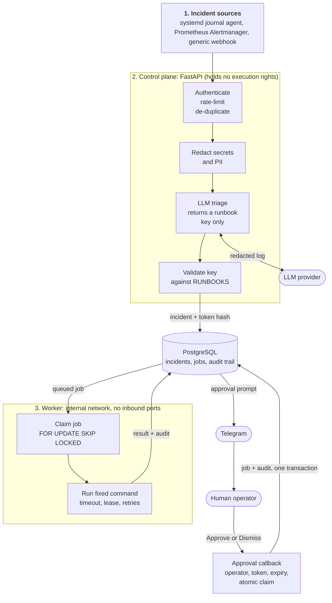
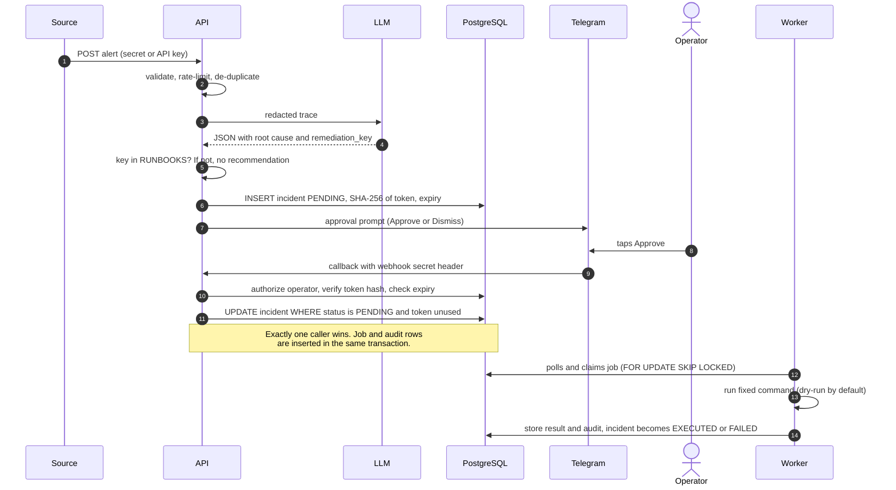

# GreenLight

 

AI-assisted incident triage with human approval. GreenLight takes an alert, asks an LLM what is wrong, sends the proposal to an operator on Telegram, and only runs a pre-approved runbook after they approve it.

The LLM never gets to run anything:

- It can only pick a **key** (for example `redis_worker_restart`) from a fixed list. The commands themselves live in code.
- A person has to approve each run with a single-use token that expires.
- Only a separate **worker** process can execute, and every step is written to an audit trail.

## Architecture

The API never executes commands. The worker has no inbound ports and no internet access. PostgreSQL is the only thing they share.



## How an incident flows



If the LLM is missing, fails, or proposes a key that is not on the list, the incident is still saved, but with no recommendation and nothing to approve.

## Quick start

```bash
cp .env.example .env
docker compose up --build        # PostgreSQL + API (127.0.0.1:8000) + worker
./scripts/simulate_incident.sh   # send a sample incident
```

Without an LLM key you will see the incident saved with `status: PENDING` and no `remediation_key`. To try the full loop, set `LLM_API_KEY` (any OpenAI-compatible endpoint) and the `TELEGRAM_*` variables in `.env`. Remediation stays in `dry-run` mode and the bundled runbooks only `echo`.

Without Docker (SQLite, no setup):

```bash
python -m venv .venv && source .venv/bin/activate
pip install -e ".[dev]"
cp .env.example .env
uvicorn greenlight.main:app --reload     # docs at http://127.0.0.1:8000/docs
python -m greenlight.worker              # second terminal
```

In development, an endpoint is open while its key is unset. With `APP_ENV=production` the API will not start until every required secret is set.

An optional n8n workflow can forward finished jobs to Slack or Discord; see [docs/integrations.md](docs/integrations.md#n8n-optional).

## API

| Endpoint | Auth | Purpose |
| --- | --- | --- |
| `POST /api/v1/incidents/ingest` | ingest API key | Create an incident |
| `GET /api/v1/incidents`, `GET /api/v1/incidents/{id}` | read API key | List or fetch incidents |
| `POST /api/v1/webhooks/agent` | agent secret | Linux journal watcher |
| `POST /api/v1/webhooks/alertmanager` | Alertmanager secret | Prometheus alerts |
| `POST /api/v1/webhooks/generic` | generic secret | Any tool that can send JSON |
| `POST /api/v1/webhooks/telegram` | Telegram secret header | Approve or dismiss |
| `GET /health` | none | Liveness |

## Project layout

```text
src/greenlight/
├── api/         routes and middleware
├── core/        config, logging, security, redaction filter
├── db/          engine and models
├── services/    triage, runbooks, ingestion, audit, Telegram client
└── worker/      job queue and execution loop
tests/           unit/ and integration/ (mirrors src/)
docs/            architecture, security, configuration, integrations, deployment
database/        schema.sql
agents/          systemd journal watcher
deploy/          Caddy and systemd files
```

## Development

```bash
make check          # ruff lint + format check, then tests
make test-postgres  # needs TEST_POSTGRES_URL pointing at a PostgreSQL database
```

The test suite covers approval races, token expiry, the allowlist, the redaction filter and worker recovery. CI runs it on SQLite and PostgreSQL, applies `schema.sql` to a clean database, and checks that the Docker image runs as a non-root user.

## Limitations

- The bundled runbooks only `echo`. Real ones must be safe to run twice, because a job can be retried.
- Redaction is pattern matching and can miss secrets; see [docs/security.md](docs/security.md).
- The request size limit uses the `Content-Length` header, so chunked uploads are not capped.
- The rate limiter lives in memory, so it is per instance.
- No versioned migrations yet (`schema.sql` plus `create_all`).

More in [architecture](docs/architecture.md), [security](docs/security.md), [configuration](docs/configuration.md), [integrations](docs/integrations.md) and [deployment](docs/deployment.md).

## License

[MIT](LICENSE)
