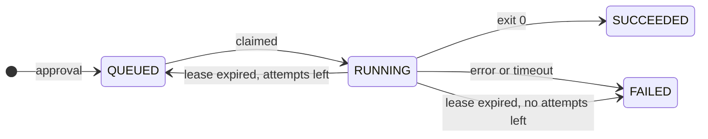

# Architecture

The README shows the components and the request flow. This page covers the parts that are easy to get wrong.

## What the model is allowed to do

The LLM returns a JSON diagnosis that includes a `remediation_key`. The key must be one of the entries in `RUNBOOKS` (`src/greenlight/services/runbooks.py`), which is the only place commands are defined. If the LLM is not configured, fails, returns invalid JSON, or names an unknown key, the incident is still saved, with no recommendation and confidence `0`, and Telegram shows no approve button.

## Approval

Approving is one conditional `UPDATE ... WHERE status = 'PENDING' AND approval_used_at IS NULL`. If two people click at once, only one update matches a row. The job row and its audit row are inserted in the same transaction. The approval token is random, expires after `APPROVAL_TTL_SECONDS` (300 by default), and only its SHA-256 hash is stored.

## Worker and job states

The worker claims jobs with `FOR UPDATE SKIP LOCKED`, so two workers never take the same job. If a worker dies, the job's lease (`WORKER_LEASE_SECONDS`) expires and the job is requeued, up to `WORKER_MAX_ATTEMPTS`; after that it fails and an audit entry is written. A requeued job can run again, so runbooks must be safe to repeat.

## Data model

| Table | Holds |
| --- | --- |
| `operators` | Telegram IDs allowed to approve, with role and enabled flag |
| `incidents` | The alert, the diagnosis, status, and the approval token hash and expiry |
| `remediation_jobs` | One job per approved incident: status, attempts, lease time, result |
| `incident_audits` | Append-only record of who did what (never tokens or raw Telegram updates) |

`database/schema.sql` creates these for PostgreSQL. Ids are UUID strings stored as `VARCHAR(36)`, matching the models. A test checks that the SQL file and the models list the same columns.
